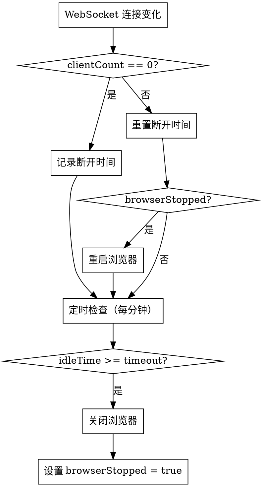

# 浏览器空闲超时释放功能设计文档

**日期**: 2026-08-15
**目标**: 添加浏览器空闲超时释放功能，当没有客户端连接超过指定时间时自动关闭浏览器以节省资源

## 背景

当前 BrowserSession 重构后，浏览器实例由 BrowserSession 统一管理。但在生产环境中，可能长时间没有客户端连接，浏览器实例会持续占用内存和 CPU 资源。

需要添加空闲超时机制：
- 当所有客户端断开连接超过指定时间后，自动关闭浏览器
- 当新客户端连接时，如果浏览器已关闭，自动重启

## 设计目标

1. **节省资源**: 长时间空闲时释放浏览器资源
2. **自动恢复**: 新客户端连接时自动重启浏览器
3. **可配置**: 通过环境变量配置超时时间
4. **低耦合**: 独立模块，不影响现有架构
5. **透明**: 详细日志记录，便于监控和调试

## 核心设计

### 配置

**环境变量**: `MAGPIE_IDLE_TIMEOUT`
- 类型: 数字（分钟）
- 默认值: 30 分钟
- 特殊值: 0 或负数表示禁用空闲超时

**配置示例**:
```bash
# 30 分钟超时（默认）
MAGPIE_IDLE_TIMEOUT=30

# 禁用空闲超时
MAGPIE_IDLE_TIMEOUT=0

# 60 分钟超时
MAGPIE_IDLE_TIMEOUT=60
```

### 架构设计

**新增模块**: `src/utils/IdleTimeoutManager.js`

**职责划分**:
- **WebSocketManager**: 跟踪连接状态，发射 `connection-change` 事件
- **IdleTimeoutManager**: 管理空闲超时逻辑，控制浏览器启停
- **index.js**: 协调各个组件，注入依赖关系

### IdleTimeoutManager 类设计

**构造函数参数**:
```javascript
constructor({ browserSession, streamerPeer, timeoutMinutes = 30 })
```

**主要方法**:
- `start()`: 启动空闲超时管理
- `stop()`: 停止空闲超时管理
- `handleConnectionChange(clientCount)`: 处理连接数量变化

**内部状态**:
- `_lastDisconnectTime`: 最后一个客户端断开的时间戳
- `_browserStopped`: 浏览器是否已停止
- `_checkInterval`: 定时检查器

**核心流程**:



### WebSocketManager 修改

**继承 EventEmitter**:
```javascript
import { EventEmitter } from 'events';

export class WebSocketManager extends EventEmitter {
  constructor() {
    super();
    this.clients = new Set();
  }

  add(ws) {
    this.clients.add(ws);
    this.emit('connection-change', this.clients.size);
    
    ws.on('close', () => {
      this.clients.delete(ws);
      this.emit('connection-change', this.clients.size);
    });
  }
  
  // ... 其他方法保持不变
}
```

### index.js 集成

```javascript
import { IdleTimeoutManager } from "./utils/IdleTimeoutManager.js";

async function main() {
  // ... 现有代码 ...
  
  // 创建空闲超时管理器
  const idleTimeoutManager = new IdleTimeoutManager({
    browserSession,
    streamerPeer,
    timeoutMinutes: Number(process.env.MAGPIE_IDLE_TIMEOUT || 30)
  });
  
  // 监听连接变化
  wsManager.on('connection-change', (clientCount) => {
    idleTimeoutManager.handleConnectionChange(clientCount);
  });
  
  // 启动空闲超时管理
  idleTimeoutManager.start();
  
  // shutdown 时清理
  const shutdown = async () => {
    idleTimeoutManager.stop();
    server.close();
    try { await streamerPeer.stop(); } catch {}
    try { await browserSession.stop(); } catch {}
    process.exit(0);
  };
}
```

## 边界情况处理

### 1. IDLE_TIMEOUT 为 0 或负数
```javascript
if (this._timeoutMinutes <= 0) {
  console.log('[IdleTimeout] Idle timeout disabled');
  return;  // 不启动定时检查
}
```

### 2. 浏览器重启失败
```javascript
// 在 _ensureBrowserRunning 中
// 如果重启失败，保持 browserStopped = true
// 下次连接时会重试
// 记录错误日志但不阻止客户端连接
```

### 3. 空闲检查期间有新连接
```javascript
// connection-change 事件处理器会重置 _lastDisconnectTime
// 下次检查时 idleTime 会重新计算，不会触发关闭
```

### 4. 服务关闭时的清理
```javascript
// shutdown 函数中调用 idleTimeoutManager.stop()
// 清理定时器，防止内存泄漏
```

### 5. 浏览器崩溃恢复与空闲超时的冲突
```javascript
// onCrash 处理器重启浏览器后
// 需要确保 browserStopped 标志正确
browserSession.onCrash = async () => {
  await browserSession.restart();
  // browserStopped 会在 ensureBrowserRunning 中重置
};
```

### 6. 定时器检查间隔
```javascript
// 每分钟检查一次，平衡精度和性能
setInterval(() => this._checkIdle(), 60 * 1000);
```

## 日志格式

统一使用 `[IdleTimeout]` 和 `[Connection]` 前缀：

```
[IdleTimeout] Idle timeout enabled: 30 minutes
[Connection] Client count: 1
[Connection] Client count: 0
[Connection] Last client disconnected, idle timer started
[IdleTimeout] Browser idle for 30.2 minutes, stopping...
[IdleTimeout] Browser stopped successfully
[Connection] Client count: 1
[IdleTimeout] New client connecting, restarting browser...
[IdleTimeout] Browser restarted successfully
```

## 文件改动清单

### 新增文件
1. **src/utils/IdleTimeoutManager.js** - 空闲超时管理器类

### 修改文件
1. **src/websocket/WebSocketManager.js** - 继承 EventEmitter，添加 `connection-change` 事件
2. **src/index.js** - 创建和启动 IdleTimeoutManager
3. **src/config.js** - 添加 IDLE_TIMEOUT 配置（可选，也可以直接在 index.js 中读取环境变量）

## 测试计划

### 单元测试
- IdleTimeoutManager 启动和停止
- handleConnectionChange 方法的状态管理
- _checkIdle 方法的超时逻辑
- _ensureBrowserRunning 方法的重启逻辑

### 集成测试
- 客户端断开超时后浏览器关闭
- 新客户端连接时自动重启浏览器
- 超时期间有新连接取消关闭
- IDLE_TIMEOUT=0 时禁用空闲超时

### 手动测试清单
- [ ] 启动服务，连接客户端
- [ ] 断开所有客户端
- [ ] 等待超时时间，验证浏览器已关闭
- [ ] 新客户端连接，验证自动重启
- [ ] 检查日志输出符合预期
- [ ] 测试 IDLE_TIMEOUT=0 禁用功能

## 风险评估

| 风险 | 影响 | 概率 | 缓解措施 |
|------|------|------|----------|
| 浏览器重启失败 | 新客户端无法使用 | 低 | 添加重试机制，记录错误日志 |
| 定时器内存泄漏 | 长期运行资源占用 | 极低 | shutdown 时确保清理定时器 |
| 空闲判断错误 | 意外关闭浏览器 | 极低 | 充分测试边界情况 |
| 与崩溃恢复冲突 | 状态不一致 | 低 | 确保 browserStopped 标志正确管理 |

## 监控指标

实现后建议关注：
- **浏览器关闭次数**: 通过日志统计
- **浏览器重启成功率**: 应该保持 100%
- **平均空闲时长**: 了解资源节省效果
- **重启延迟**: 从新连接到浏览器可用的时间

## 成功标准

1. 所有单元测试和集成测试通过
2. 手动测试清单全部验证通过
3. 空闲超时后浏览器成功关闭
4. 新客户端连接时浏览器成功重启
5. 日志输出清晰，便于监控
6. IDLE_TIMEOUT=0 时功能正常禁用

## 后续优化（可选）

1. **优雅降级**: 浏览器重启失败时的错误处理和通知机制
2. **统计信息**: 记录空闲次数、重启次数等指标
3. **动态调整**: 支持运行时动态修改超时时间
4. **预热机制**: 在预期有连接前提前启动浏览器
5. **健康检查**: 添加空闲超时管理器的状态检查接口

## 参考

- [[magpie-capture-headless-constraint]] - 为什么使用 CDP screencast + relay canvas
- [[no-web-search]] - 用户偏好：不使用 WebSearch/WebFetch